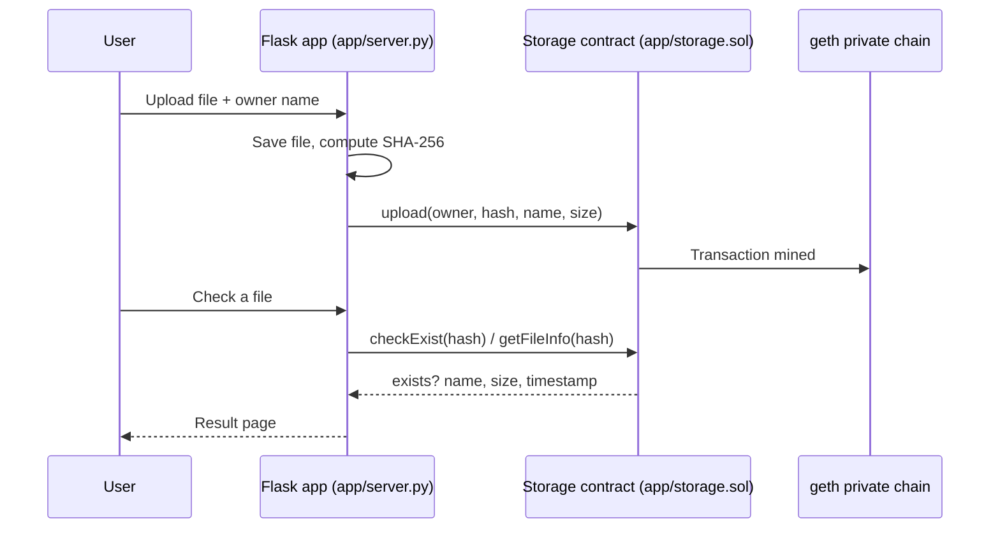

# Blockchain E-Filing System

A small Flask web app that records a SHA-256 fingerprint of each uploaded file on a private Ethereum chain, so anyone can later check whether a file is unchanged and who registered it.

> **Attribution:** this is a study copy based on [JungWinter/file-on-blockchain](https://github.com/JungWinter/file-on-blockchain) (2017), which has the same structure and set-up steps. That repository does not publish a licence.

## How it works



- **Smart contract (`app/storage.sol`, Solidity ^0.4.16):** owner-restricted `upload`, `checkExist`, `getOwnerName` and `getFileInfo` functions.
- **Web app (`app/server.py`, `app/contract.py`):** upload form (txt, pdf, png, jpg, jpeg, gif; 16 MB limit), hash calculation and contract calls through web3.py.
- **Chain (`blockchain/`):** custom genesis file and scripts to start a local `geth` node.

## Running it

The code targets 2017-era tooling (Solidity 0.4, geth with the `--rpc` flags, early web3.py and `py-solc`, and `werkzeug.secure_filename`, which moved in Werkzeug 1.0). It will not run on current versions without changes; the steps below describe the original workflow.

1. Start a private chain:

   ```bash
   cd blockchain
   ./init.sh     # initialise chain-data from CustomGenesis.json
   ./start.sh    # start geth with RPC on the custom network
   ```

2. In another terminal, attach to the node, create an account and mine a few blocks:

   ```bash
   geth attach ./chain-data/geth.ipc
   > personal.newAccount()
   > miner.start(); miner.stop()
   ```

3. Optionally deploy the example contract: `python example/deploy_contract_and_test.py`.
4. Run the web app: `cd app && python server.py`.

## Limitations

- Pinned to deprecated Ethereum tooling; not maintained.
- `start.sh` opens RPC to all origins with admin APIs enabled, which is only acceptable on an isolated local machine.
- Files are stored on the web server's disk; only their hashes go on-chain.

## Author

Maintained by **S M Mahamudul Hasan** · [GitHub](https://github.com/hasansust32)
